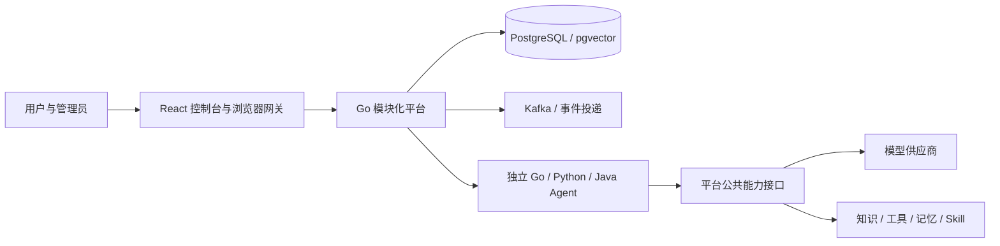

<div align="center">

# AgentPlug

**让业务 Agent 专注业务，让平台统一处理运行、权限与公共能力。**

**简体中文** · [English](README_EN.md) · [日本語](README_JA.md) · [Deutsch](README_DE.md)

[解决的痛点](#解决的痛点) · [适用人群](#适用人群) · [快速开始](#快速开始) · [三种部署方式](#三种部署方式) · [业务 Agent 开发](#业务-agent-开发) · [架构](#架构) · [开发者文档](docs/developer/zh/README.md) · [业务 Agent 交付 skill](skills/agentplug-business-agent/SKILL.md)

</div>

AgentPlug 是面向企业的智能体开发、运行与治理平台。使用 **Go、Python、Java** 编写业务 Agent，将它独立部署，再提供给指定公司、部门和用户。Agent 通过 SDK 复用模型、知识检索、工具、记忆、检查点和协作能力，无需在每个业务项目中重建基础设施。

控制台支持 **中文 / English**，登录页和顶部都有明显的语言切换按钮。本文面向开发者；业务用户从[用户手册](docs/用户手册/README.md)开始。

## 解决的痛点

把一个 Agent 做成演示后，还需要解决运行、上线、授权和维护的问题。团队开发的 Agent 越多，这些重复工作越容易成为交付瓶颈。

| 你可能遇到的问题 | AgentPlug 的处理方式 |
| --- | --- |
| 每个业务 Agent 都要重复接模型、知识库、工具和记忆 | 通过 SDK 调用平台公共能力，让业务代码集中实现业务流程；具体能力仍需配置和授权 |
| Go、Python、Java 团队交付方式不同，接入和维护困难 | 提供三语言 SDK、模板和统一执行契约，业务 Agent 独立部署 |
| Agent 已启动，却不知道如何交给指定公司、部门和用户使用 | 将版本发布、安装、部署就绪和使用授权分开管理，按公司 → 部门 → Agent 确定使用范围 |
| 用户增多后，逐人逐项赋权工作量大，容易错授 | 公司管理员设定部门授权上限，部门管理员在上限内批量分配；提交前预览影响，提交后查看逐人结果 |
| 任务执行失败后，难以追踪原因、取消任务或继续会话 | 统一管理运行状态、事件、取消、会话历史和审计，保留排查与验收依据 |
| 新开发者看懂了示例，却不知道如何开发和交付自己的 Agent | 提供架构与源码地图、公共能力说明、开发教程和交付 skill，串联开发、测试、部署及组织授权 |

## 适用人群

| 人群 | 可以从 AgentPlug 获得什么 | 建议入口 |
| --- | --- | --- |
| 业务 Agent 开发者 | 使用 Go、Python 或 Java 实现业务流程，复用公共能力并交付给目标用户 | [开发者入门路线](docs/developer/zh/README.md) |
| 企业平台团队、架构师 | 理解执行与治理边界，统一多个团队的 Agent 接入，并评估平台扩展方式 | [架构与源码地图](docs/developer/zh/architecture.md) · [公共能力](docs/developer/zh/capabilities.md) |
| 二次开发与开源贡献者 | 了解模块职责、契约和扩展点，开发新的能力或接入方式 | [二次开发指南](docs/developer/zh/extending.md) |
| 部署与运维人员 | 选择主机、Docker 或 K8s 部署，配置运行环境并进行上线验收 | [部署指南](docs/developer/zh/deployment.md) |
| 公司管理员、部门管理员 | 管理部门和成员，设定 Agent 使用范围，办理批量授权与审批 | [公司与部门 Agent 授权指南](docs/开发者指南/公司与部门Agent授权指南.md) |
| 企业业务用户 | 找到已获授权的助手，执行任务并查看结果和历史 | [用户手册](docs/用户手册/README.md) |

首次体验可以从单机 Docker 部署开始；计划投入企业生产环境时，需要结合自己的基础设施、业务数据和权限规则完成部署与验收。

## 开发者从这里开始

第一次接触 AgentPlug，建议按下面的顺序理解项目、运行工程，再交付业务 Agent。

**[开发者文档](docs/developer/zh/README.md)是给开发者阅读和执行的项目指南。** 它解释平台架构、核心组件与公共能力，以及业务代码和平台的职责边界；再带你选择部署方式、配置环境、从模板开发和测试 Agent，最后完成发布与公司、部门、用户授权。第一次使用从文档首页的入门路线按顺序阅读；二次开发时按架构、公共能力和扩展章节查阅。

**[业务 Agent 开发与交付 skill](skills/agentplug-business-agent/SKILL.md)是给代码助手使用的工作流程。** 把它交给支持 skill 的助手，并提供平台仓库路径、业务目标、部署环境和目标公司 / 部门 / 用户；助手会据此开发业务代码、检查公共能力复用和遗漏项、执行测试，再完成已授权的部署与绑定，输出运行证据和验收清单。[安装与使用指南](docs/developer/zh/skill.md)说明如何直接引用或安装它。建议先读开发者文档理解流程，再让助手按 skill 协助执行，最终用普通业务账号验收实际运行结果。

| 顺序 | 入口 | 你能完成什么 |
| --- | --- | --- |
| 1. 熟悉项目 | [开发者文档：部署、架构、公共能力与业务开发](docs/developer/zh/README.md) | 理解核心组件和平台 / Agent 分工，选择本地、Docker 或 K8s 部署方式 |
| 2. 跑通第一个 Agent | [部署快速开始](docs/developer/zh/quickstart.md) → [业务 Agent 实战教程](docs/developer/zh/first-agent.md) | 部署基础平台，从模板编写业务代码、测试并构建镜像 |
| 3. 借助代码助手完成交付 | [业务 Agent 开发与交付 skill](skills/agentplug-business-agent/SKILL.md) · [安装与使用](docs/developer/zh/skill.md) | 指导公共能力复用审查、运行测试、部署及公司 / 部门 / 用户绑定 |
| 4. 完整走通并验收 | [从空平台到用户运行自己的 Agent](docs/developer/zh/walkthrough.md) | 一条命令执行隔离部署、开发、测试、独立发布、组织授权及普通用户真实运行，保留证据并清理临时环境 |

## 核心能力

| 需求 | 平台提供什么 |
| --- | --- |
| 多个团队各自开发 Agent | 三语言 SDK、六种模板、统一执行协议、独立部署 |
| 共享模型接入 | 模型网关、供应商密钥管理、版本、价格与预算治理 |
| 企业知识和工具 | 带权限的知识检索、受控工具调用、记忆和 Skill |
| 把助手交给不同部门 | 公司工作空间 → 部门 → 可用 Agent；成员管理与批量赋权 |
| 知道任务发生了什么 | 运行、事件、取消、会话历史、审计和评测证据 |
| 二次开发平台 | 模块边界、公共契约、源码地图和扩展说明 |

## 快速开始

第一次使用推荐 **Docker Compose**。需要 Python 3.12+、Docker Engine / Docker Desktop 和 Compose v2。下载仓库后，在根目录执行：

```text
python -m pip install "cryptography>=43,<46"
python scripts/prepare_local_development.py
python scripts/compose.py config --env-file .env
python scripts/init_platform.py --env-file .env
python scripts/bootstrap_first_admin.py --env-file .env --config .local-secrets/first-admin.json
python scripts/compose.py up --env-file .env
python scripts/compose.py smoke --env-file .env
```

准备命令让你输入首位管理员密码，并生成独立随机凭据、执行签名密钥、`.env` 和私有管理员配置；不会启动服务或覆盖已有文件。启动后打开 **http://127.0.0.1:3000**，使用 **`platform.admin`** 和刚才输入的密码登录。

> [!TIP]
> 已有部署继续使用原配置和账号。端口被占用时，在首次准备前指定 `--frontend-port`、`--postgres-port`、`--platform-port`、`--internal-port`，例如 `--frontend-port 33000 --postgres-port 35432`。

初始目录没有业务 Agent 是正常的：基础栈就绪后，还要开发、发布、部署并授权助手。模型供应商不会因为平台健康就自动配置完成。

[逐步说明与预期结果](docs/developer/zh/quickstart.md) · [配置从哪里开始填](docs/developer/zh/configuration.md) · [排障](docs/developer/zh/troubleshooting.md)

## 三种部署方式

| 方式 | 适用场景 | 入口 | 当前边界 |
| --- | --- | --- | --- |
| 本地源码 / 主机进程 | 调试平台和公共能力 | `scripts/local.py build`、`local.py run` | 自备 PostgreSQL + pgvector；各进程独立配置 |
| Docker Compose | 首次体验、集成与单机部署 | 根目录 `compose.yaml`，`scripts/compose.py` | 平台、前端、PostgreSQL、Kafka、Metric Runner；Agent 按需加入 |
| Kubernetes | 集群运维、独立工作负载部署 | `deploy/k8s/production/`，Kustomize + `apply.ps1` | 生产候选模板，需补齐真实基础设施并做集群验收 |

### 本地源码运行

安装 Go 1.25+、Node.js 20+、Python 3.12+，准备 PostgreSQL 16 + pgvector。Java Agent 另需 JDK 21 和 Maven。按[本地部署步骤](docs/developer/zh/deployment.md#本地源码与主机进程)填写迁移、平台、前端、Runner 四份私有配置。

```text
python scripts/local.py build
python scripts/local.py run migrate --env-file .local-secrets/local/migration.env
python scripts/local.py bootstrap-admin --config .local-secrets/local/first-admin.json
```

随后分别在三个终端运行：

```text
python scripts/local.py run runner --env-file .local-secrets/local/runner.env
python scripts/local.py run platform --env-file .local-secrets/local/platform.env
python scripts/local.py run frontend --env-file .local-secrets/local/frontend.env
```

应用以主机进程运行，前端模板端口为 **33000**。主机配置与 Compose 根目录 `.env` 有不同的参数名，不能直接混用。

### Docker Compose

上方快速开始就是基础栈部署流程。根目录只保留一个 `compose.yaml`，扩展集中在 [`deploy/compose/`](deploy/compose/README.md)，由脚本选择。

```text
python scripts/compose.py status --env-file .env
python scripts/compose.py down --env-file .env
```

`down` 保留数据卷。添加三个 SDK 示例用 `--examples`，先按[交付说明](docs/developer/zh/delivery.md)准备工作负载凭据和发布策略。Code Runtime 另需 `--runtime`。生产配置见[Compose 生产说明](deploy/compose/README-production.md)。

### Kubernetes

已有平台、前端、Metric Runner、OIDC 代理四个 Deployment，以及迁移 Job、Service、Ingress、NetworkPolicy 和外部服务覆盖层。

```text
kubectl kustomize deploy/k8s/production
```

此命令只渲染，不部署。按[K8s 部署步骤](docs/developer/zh/deployment.md#kubernetes-集群部署)准备自己的覆盖层、真实镜像摘要和外部 Secret，通过发布预检与签名验证后使用 `deploy/k8s/production/apply.ps1`。

**平台内部目前是 Go 模块化单体。** K8s 支持将平台、网关、Runner 和业务 Agent 作为独立服务部署，但尚未把 Identity、Catalog、Knowledge 等所有模块拆成独立微服务。平台候选配置为单副本，增加副本数不等于已完成高可用验收。

## 业务 Agent 开发

从仓库根目录开始：

```text
cd cli/agentctl
go run ./cmd/agentctl create --template python-generic --language python --name support-assistant --output out/support-assistant
go run ./cmd/agentctl validate --path out/support-assistant
cd ../..
```

业务代码放在 `domain/`，通过 SDK 接缝接入。`platform_entry/` 和 `template.lock` 由模板管理。[第一个 Agent 教程](docs/developer/zh/first-agent.md)提供可复制运行的业务代码、测试、容器构建和接入步骤。**Manifest 验证不等于发布、上线或取得使用权限。**

| 语言 | 通用 / 框架模板 | 完整业务示例 |
| --- | --- | --- |
| Go | `go-generic` / `go-eino` | [运维助手](examples/go-operations/README.md) |
| Python | `python-generic` / `python-langgraph` | [文档问答](examples/python-documents/README.md) |
| Java | `java-generic` / `java-spring-ai` | [工单助手](examples/java-tickets/README.md) |

仓库提供 [`agentplug-business-agent`](skills/agentplug-business-agent/SKILL.md) skill，协助开发、公共能力复用审查、运行测试、部署和公司 / 部门 / 用户绑定。[安装与使用](docs/developer/zh/skill.md)。它按授权执行具体交付计划，保留验收证据；健康检查只是业务验收的一部分。

## 架构



控制面管理组织、身份、版本、安装、策略发布和审计。执行面处理任务、事件、取消、恢复与能力调用。业务 Agent 拥有业务流程，不拥有平台数据库或供应商密钥。模块间通过端口接口交互，表所有权和架构测试约束边界。

[架构与源码地图](docs/developer/zh/architecture.md) · [公共能力复用](docs/developer/zh/capabilities.md) · [二次开发](docs/developer/zh/extending.md)

## 组织与权限

一个用户属于一个公司工作空间，可加入多个部门，使用部门获准的 Agent。用户界面的“应用”指业务 Agent，内部 Application 是安装与策略容器。

平台管理员、公司管理员、部门管理员和部门用户各有管理边界。公司管理员设定部门可用 Agent，部门管理员在上限内给其他成员分配使用权；可选权限管理员承担明确委派的审批工作。

管理身份不自动赋予 Agent 运行权。调用人和工作负载身份分别授权；成员关系也不自动开通助手。批量赋权先预览影响，再认证、提交并查看逐人结果。[完整规则](docs/开发者指南/公司与部门Agent授权指南.md)。

## 文档与开发

| 任务 | 文档 |
| --- | --- |
| 第一次认识和部署平台 | [开发者入门路线](docs/developer/zh/README.md) |
| 理解配置用途和填写时机 | [分层配置参考](docs/developer/zh/configuration.md) |
| 发布、部署、绑定业务 Agent | [交付与授权](docs/developer/zh/delivery.md) |
| 使用助手、管理成员 | [用户手册](docs/用户手册/README.md) |
| 深入 SDK | [三语言 SDK 指南](docs/开发者指南/三语言SDK业务Agent开发指南.md) |
| 业务评测 | [Agent Evaluation](cli/agent-eval/README.md) |
| 备份和恢复 | [备份](deploy/backup/README.md) · [数据生命周期](docs/DATA-LIFECYCLE.md) · [运行恢复](docs/RUNTIME-RECOVERY.md) |

平台在 `platform/` 运行 `go test ./...`；前端在 `frontend/` 运行 `npm ci`、`npm test`、`npm run build`。在根目录运行：

```text
python scripts/check_markdown_links.py
python scripts/check_publication.py
python scripts/scan_secrets.py
python scripts/verify_modular_boundaries.py
```

数据库、真实供应商与 Code Runtime 测试需对应环境，见[贡献指南](CONTRIBUTING.md)。空库隔离端到端入口为 `python scripts/compose.py e2e-modular`。

## 当前状态

项目持续开发中。上线需在目标环境验收身份、权限、策略、业务运行、网络、备份和恢复；K8s 模板不代表已完成真实生产集群验收。

可选 Code Runtime 依赖 Linux Landlock ABI 3、受限网络、固定镜像摘要和明确风险批准。模板的进程内 `MemoryRunStore` 用于入门；持久恢复、多实例运行需实现作用域匹配的持久 Store 并验证协议。

[贡献指南](CONTRIBUTING.md) · [安全报告](SECURITY.md) · [MIT License](LICENSE) · [第三方声明](THIRD_PARTY_NOTICES.md)
