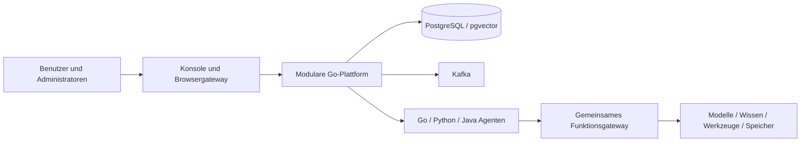

<div align="center">

# AgentPlug

**Geschäftsagenten entwickeln. Ausführung, Rechte und gemeinsame Funktionen zentral verwalten.**

[简体中文](README.md) · [English](README_EN.md) · [日本語](README_JA.md) · **Deutsch**

[Welche Probleme AgentPlug löst](#welche-probleme-agentplug-löst) · [Für wen AgentPlug geeignet ist](#für-wen-agentplug-geeignet-ist) · [Schnellstart](#schnellstart) · [Bereitstellung](#bereitstellung) · [Agenten entwickeln](#agenten-entwickeln) · [Architektur](#architektur) · [Entwicklerleitfaden](docs/developer/de/README.md) · [Skill zur Agentenbereitstellung](skills/agentplug-business-agent/SKILL.md)

</div>

**Neue gemeinsame Funktionen:** Modellrouting, strukturierte Ausgaben, persistente Workflows, aktuelle Referenzberechtigungen sowie Kafka-Benachrichtigungen und Kompensation bei Abbruch. SDK-Funktionen: 2.1.0, Vorlagen: 1.1.0, Beispielagenten: 0.3.0 mit v3-Schemas. [Funktionen und Kompatibilität auf Englisch](docs/releases/public-capabilities-2.1.en.md).

AgentPlug ist eine Plattform für Entwicklung, Ausführung und Governance von Unternehmensagenten. Erstellen Sie Agenten in **Go, Python oder Java**, stellen Sie diese unabhängig bereit und geben Sie sie für ausgewählte Unternehmen, Abteilungen und Benutzer frei. Über die SDKs nutzen Agenten gemeinsame Modellzugriffe, Wissenssuche, Werkzeuge, Speicher, Checkpoints und Zusammenarbeit.

Die Konsole unterstützt **Chinesisch / Englisch**, mit sichtbaren Schaltern bei der Anmeldung und in der Kopfleiste. Die deutsche Dokumentation bedeutet keine deutsche Benutzeroberfläche. Für Anwender gibt es ein [englisches Handbuch](docs/用户手册/README.en.md).

## Welche Probleme AgentPlug löst

Nach einer funktionierenden Agentendemo folgen Betrieb, Bereitstellung, Rechtevergabe und Wartung. Mit jedem weiteren Agenten können diese wiederkehrenden Aufgaben die Bereitstellung verzögern.

| Problem | Ansatz von AgentPlug |
| --- | --- |
| Jeder Agent implementiert Modellzugriff, Suche, Werkzeuge und Speicher erneut | SDKs stellen gemeinsame Funktionen bereit, damit Geschäftslogik im Agenten bleibt; die Funktionen müssen weiterhin konfiguriert und freigegeben werden |
| Go-, Python- und Java-Teams verwenden unterschiedliche Integrationswege | Drei SDK-Sprachen, Vorlagen und ein gemeinsamer Ausführungsvertrag unterstützen unabhängig bereitgestellte Agenten |
| Ein laufender Agent ist noch nicht den richtigen Unternehmen, Abteilungen und Benutzern zugeordnet | Veröffentlichung, Installation, Betriebsbereitschaft und Zugriff werden getrennt verwaltet; Grenzen folgen Unternehmen → Abteilung → Agent |
| Einzelne Rechte pro Benutzer zu vergeben wird aufwendig und fehleranfällig | Unternehmensadministratoren setzen Abteilungsgrenzen; Abteilungsadministratoren vergeben Rechte innerhalb dieser Grenzen gesammelt, mit Vorschau und Ergebnissen pro Benutzer |
| Fehlgeschlagene Aufgaben lassen sich schwer nachverfolgen, abbrechen oder fortsetzen | Gemeinsame Laufzustände, Ereignisse, Abbruch, Gesprächsverlauf und Audit liefern Nachweise für Fehlersuche und Abnahme |
| Neue Entwickler verstehen Beispiele, aber nicht den Weg zum eigenen bereitgestellten Agenten | Architektur, Codeübersicht, Funktionsleitfäden, Tutorials und der Bereitstellungs-Skill verbinden Entwicklung, Tests, Deployment und organisatorische Freigaben |

## Für wen AgentPlug geeignet ist

| Zielgruppe | Einsatz | Einstieg |
| --- | --- | --- |
| Entwickler von Geschäftsagenten | Abläufe in Go, Python oder Java implementieren, gemeinsame Funktionen nutzen und Agenten Benutzern bereitstellen | [Entwicklerleitfaden](docs/developer/de/README.md) |
| Plattformteams und Architekten | Ausführungs- und Verwaltungsgrenzen verstehen, Integrationen vereinheitlichen und Erweiterungen beurteilen | [Architektur und Codeübersicht (Englisch)](docs/developer/en/architecture.md) · [Gemeinsame Funktionen (Englisch)](docs/developer/en/capabilities.md) |
| Entwickler von Erweiterungen und Open-Source-Mitwirkende | Modulzuständigkeiten, Verträge und Erweiterungspunkte kennenlernen | [Erweiterungsleitfaden (Englisch)](docs/developer/en/extending.md) |
| Bereitstellungs- und Betriebsteams | Host, Docker oder K8s auswählen, Infrastruktur konfigurieren und Veröffentlichungen prüfen | [Bereitstellungsleitfaden (Englisch)](docs/developer/en/deployment.md) |
| Unternehmens- und Abteilungsadministratoren | Abteilungen, Mitglieder, Agentenzugriff, gesammelte Rechtevergabe und Genehmigungen verwalten | [Bereitstellung und organisatorische Freigaben (Englisch)](docs/developer/en/delivery.md) |
| Geschäftsanwender | Freigegebene Assistenten nutzen sowie Ergebnisse und Verlauf prüfen | [Benutzerhandbuch (Englisch)](docs/用户手册/README.en.md) |

Zur Bewertung eignet sich zunächst Docker auf einem einzelnen Host. Der produktive Unternehmenseinsatz erfordert Bereitstellung und Abnahme anhand Ihrer Infrastruktur, Geschäftsdaten und Zugriffsregeln.

## Einstieg für Entwickler

Folgen Sie dieser Reihenfolge: das Projekt verstehen, einen ersten Agenten ausführen und ihn anschließend Benutzern bereitstellen. Die ausführlichen technischen Anleitungen und der Skill sind auf Englisch.

**Die [Entwicklerdokumentation](docs/developer/de/README.md) ist die Anleitung zum Lesen und Ausführen.** Sie erklärt Architektur, Kernkomponenten, gemeinsame Funktionen und die Zuständigkeiten von Plattform und Geschäftslogik. Anschließend führt sie durch Konfiguration, Bereitstellung, Entwicklung, Tests, Veröffentlichung und Freigaben für Unternehmen / Abteilungen / Benutzer. Folgen Sie beim Einstieg der Lernroute; nutzen Sie bei Erweiterungen die Kapitel zu Architektur, gemeinsamen Funktionen und Erweiterungspunkten.

**Der [Skill für Entwicklung und Bereitstellung von Geschäftsagenten](skills/agentplug-business-agent/SKILL.md) ist ein Arbeitsablauf für Ihren Coding-Assistenten.** Übergeben Sie die Datei zusammen mit Repository-Pfad, Geschäftsanforderungen, Zielumgebung und gewünschten Unternehmen / Abteilungen / Benutzern. Der Assistent unterstützt Implementierung, Prüfung der Wiederverwendung, Tests sowie genehmigte Bereitstellung und Zuordnung und liefert Laufzeitnachweise und eine Abnahmeliste. Die [Nutzungsanleitung](docs/developer/en/skill.md) beschreibt direkten Aufruf und Installation. Lesen Sie zuerst den Entwicklerleitfaden, lassen Sie sich danach mit dem Skill unterstützen und prüfen Sie das Ergebnis mit einem normalen Geschäftskonto.

| Schritt | Einstieg | Ergebnis |
| --- | --- | --- |
| 1. Das Projekt verstehen | [Entwicklerleitfaden: Bereitstellung, Architektur, gemeinsame Funktionen und Agentenentwicklung](docs/developer/de/README.md) | Kernkomponenten und Zuständigkeiten von Plattform und Agent kennenlernen; lokale, Docker- oder K8s-Bereitstellung auswählen |
| 2. Den ersten Agenten ausführen | [Schnellstart zur Bereitstellung (Englisch)](docs/developer/en/quickstart.md) → [Tutorial für den ersten Geschäftsagenten (Englisch)](docs/developer/en/first-agent.md) | Basisplattform installieren, Geschäftslogik aus einer Vorlage entwickeln, testen und ein Image erstellen |
| 3. Mit einem Coding-Assistenten bereitstellen | [Skill für Entwicklung und Bereitstellung von Geschäftsagenten (Englisch)](skills/agentplug-business-agent/SKILL.md) · [Installation und Verwendung (Englisch)](docs/developer/en/skill.md) | Wiederverwendung gemeinsamer Funktionen prüfen, Laufzeittests ausführen, bereitstellen und Unternehmen / Abteilungen / Benutzer zuordnen |
| 4. Die vollständige Bereitstellung prüfen | [Von der leeren Plattform zur Benutzerausführung (Englisch)](docs/developer/en/walkthrough.md) | Einrichtung, Entwicklung, Tests, unabhängige Veröffentlichung, Rechtevergabe und echte Ausführung isoliert prüfen; Nachweise erhalten und temporäre Ressourcen entfernen |

## Funktionen

| Anforderung | Unterstützung |
| --- | --- |
| Agenten aus mehreren Teams | Drei SDK-Sprachen, sechs Vorlagen, gemeinsames Ausführungsprotokoll |
| Gemeinsamer Modellzugriff | Modellgateway, zentrale Zugangsdaten, Versionen, Preise und Budgets |
| Unternehmenswissen und Werkzeuge | Autorisierte Suche, kontrollierte Aufrufe, Speicher und Skills |
| Abteilungsbezogene Freigaben | Unternehmensarbeitsbereich → Abteilung → verfügbare Agenten, Stapelverarbeitung |
| Nachvollziehbare Ausführung | Läufe, Ereignisse, Abbruch, Verlauf, Audit und Bewertungsnachweise |
| Weiterentwicklung | Modulgrenzen, öffentliche Verträge, Codeübersicht und Erweiterungsleitfaden |

## Schnellstart

Für den Einstieg empfehlen wir **Docker Compose**. Voraussetzungen: Python 3.12+, Docker Engine / Docker Desktop und Compose v2. Führen Sie im Stammverzeichnis des heruntergeladenen Repositorys aus:

```text
python -m pip install "cryptography>=50,<51"
python scripts/prepare_local_development.py
python scripts/compose.py config --env-file .env
python scripts/init_platform.py --env-file .env
python scripts/bootstrap_first_admin.py --env-file .env --config .local-secrets/first-admin.json
python scripts/compose.py up --env-file .env
python scripts/compose.py smoke --env-file .env
```

Die Vorbereitung fragt nach dem Passwort des ersten Administrators und erzeugt unabhängige Zufallsgeheimnisse, Signaturschlüssel, `.env` und eine private Administratorkonfiguration. Sie startet keine Dienste und überschreibt keine Dateien. Melden Sie sich nach dem Start unter **http://127.0.0.1:3000** als **`platform.admin`** mit Ihrem eingegebenen Passwort an.

> [!TIP]
> Bestehende Installationen behalten ihre Konfiguration und Konten. Bei belegten Ports verwenden Sie vor der ersten Erzeugung beispielsweise `--frontend-port 33000 --postgres-port 35432`. Auch `--platform-port` und `--internal-port` sind verfügbar.

Der Agentenkatalog ist zunächst leer. Nach dem Start der Basisdienste folgen Entwicklung, Veröffentlichung, Bereitstellung und Freigabe der Agenten. Modellanbieter werden ebenfalls gesondert konfiguriert.

[Deutscher Einstieg](docs/developer/de/README.md) · [Detaillierte Schritte, Englisch](docs/developer/en/quickstart.md) · [Konfiguration, Englisch](docs/developer/en/configuration.md)

## Bereitstellung

| Methode | Einsatz | Einstieg | Aktueller Umfang |
| --- | --- | --- | --- |
| Lokaler Quellcode / Hostprozesse | Plattform entwickeln | `scripts/local.py` | PostgreSQL + pgvector bereitstellen und Prozesse getrennt konfigurieren |
| Docker Compose | Einstieg, Integration, einzelner Host | `compose.yaml`, `scripts/compose.py` | Plattform, Frontend, PostgreSQL, Kafka, Metric Runner und optionale Agenten |
| Kubernetes | Cluster und getrennte Workloads | `deploy/k8s/production/` | Produktionsvorlagen, die reale Infrastruktur und Abnahme benötigen |

### Lokaler Quellcode

Installieren Sie Go 1.26.10+, Node.js 20+, Python 3.12+ und PostgreSQL 16 + pgvector. Java-Agenten benötigen zusätzlich JDK 21 und Maven. Bereiten Sie die vier privaten Konfigurationen gemäß [Hostbereitstellung, Englisch](docs/developer/en/deployment.md#local-source-and-host-processes) vor.

```text
python scripts/local.py build
python scripts/local.py run migrate --env-file .local-secrets/local/migration.env
python scripts/local.py bootstrap-admin --config .local-secrets/local/first-admin.json
```

Starten Sie diese Prozesse jeweils in einem eigenen Terminal:

```text
python scripts/local.py run runner --env-file .local-secrets/local/runner.env
python scripts/local.py run platform --env-file .local-secrets/local/platform.env
python scripts/local.py run frontend --env-file .local-secrets/local/frontend.env
```

Die Frontendvorlage verwendet Port **33000**. Hostkonfigurationen und die Compose-Datei `.env` haben unterschiedliche Variablennamen und sind nicht austauschbar.

### Docker Compose

Der Schnellstart stellt die Basisdienste bereit. Es gibt einen Einstieg `compose.yaml` im Stammverzeichnis; Erweiterungen liegen unter [`deploy/compose/`](deploy/compose/README.md).

```text
python scripts/compose.py status --env-file .env
python scripts/compose.py down --env-file .env
```

`down` behält Datenvolumes. Mit `--examples` kommen die drei SDK-Beispiele hinzu, nachdem ihre Workload-Zugangsdaten und Richtlinien vorbereitet wurden. Code Runtime benötigt zusätzlich `--runtime`. Siehe [Auslieferung und Rechte, Englisch](docs/developer/en/delivery.md).

### Kubernetes

Vorhanden sind vier Deployments—Plattform, Frontend, Metric Runner und OIDC-Proxy—sowie ein Migrationsjob, Services, Ingress und NetworkPolicy.

```text
kubectl kustomize deploy/k8s/production
```

Dieser Befehl rendert die Vorlage, ohne Ressourcen anzuwenden. Erstellen Sie ein Betreiber-Overlay mit echten Image-Digests, externen Secrets und Netzwerkeinstellungen. Nach Vorprüfung und Signaturprüfung erfolgt die Veröffentlichung über `apply.ps1`. [Clusterleitfaden, Englisch](docs/developer/en/deployment.md#kubernetes-cluster-deployment).

**Die Go-Plattform ist derzeit ein modularer Monolith.** Kubernetes trennt Plattform, Gateway, Runner und Geschäftsagenten in Dienste; Identity, Catalog und Knowledge sind dadurch keine eigenständigen Microservices. Die Plattformvorlage verwendet eine Replik. Mehr Repliken allein belegen keine Hochverfügbarkeit.

## Agenten entwickeln

Beginnen Sie im Stammverzeichnis:

```text
cd cli/agentctl
go run ./cmd/agentctl create --template python-generic --language python --name support-assistant --output out/support-assistant
go run ./cmd/agentctl validate --path out/support-assistant
cd ../..
```

Geschäftscode liegt in `domain/` und wird über SDK-Hooks eingebunden. `platform_entry/` und `template.lock` verwaltet die Vorlage. Das [erste Agententutorial, Englisch](docs/developer/en/first-agent.md) enthält ausführbaren Geschäftscode, Tests, Containerbau und Plattformintegration. Manifestvalidierung allein veröffentlicht, startet oder autorisiert keinen Agenten.

| Sprache | Vorlagen | Geschäftsbeispiel |
| --- | --- | --- |
| Go | `go-generic` / `go-eino` | [Betriebsassistent](examples/go-operations/README.md) |
| Python | `python-generic` / `python-langgraph` | [Dokumentenassistent](examples/python-documents/README.md) |
| Java | `java-generic` / `java-spring-ai` | [Ticketassistent](examples/java-tickets/README.md) |

Der Skill [`agentplug-business-agent`](skills/agentplug-business-agent/SKILL.md) unterstützt Entwicklung, Prüfung der Wiederverwendung, Tests, Bereitstellung sowie Unternehmens-, Abteilungs- und Benutzerzuordnung. [Installation und Nutzung, Englisch](docs/developer/en/skill.md).

## Architektur



Die Steuerungsebene verwaltet Organisationen, Identitäten, Versionen, Installationen, Richtlinien und Audit. Die Ausführungsebene verwaltet Aufgaben, Ereignisse, Abbruch, Wiederherstellung und Funktionsaufrufe. Geschäftsagenten erhalten keine Plattformdatenbank-Zugangsdaten oder Anbieter-API-Schlüssel.

[Architektur, Englisch](docs/developer/en/architecture.md) · [Gemeinsame Funktionen, Englisch](docs/developer/en/capabilities.md) · [Erweiterung, Englisch](docs/developer/en/extending.md)

## Organisation und Rechte

Ein Benutzer gehört zu einem Unternehmensarbeitsbereich und kann mehreren Abteilungen angehören. Unternehmensadministratoren bestimmen verfügbare Agenten; Abteilungsadministratoren vergeben innerhalb dieser Grenzen Nutzungsrechte an andere Mitglieder. Berechtigungsadministratoren sind eine optionale delegierte Rolle.

Verwaltungsrechte enthalten keine Agentenausführung. Menschen und Workload-Identitäten werden getrennt autorisiert. Abteilungsmitgliedschaft allein aktiviert keinen Agenten. Stapeländerungen zeigen Auswirkungen vorab, benötigen erneute Authentifizierung und speichern individuelle Ergebnisse.

## Entwicklung und aktueller Stand

In `platform/`: `go test ./...`. In `frontend/`: `npm ci`, `npm test`, `npm run build`. Im Stammverzeichnis:

```text
python scripts/check_markdown_links.py
python scripts/check_publication.py
python scripts/scan_secrets.py
python scripts/verify_modular_boundaries.py
```

Das Projekt wird weiterentwickelt. Produktion erfordert eine Abnahme von Identitäten, Richtlinien, echten Geschäftsläufen, Netzwerken, Sicherungen und Wiederherstellung. K8s-Vorlagen belegen keine bereits abgenommene Produktionsinstallation. Optionale Code Runtime benötigt Linux Landlock ABI 3, eingeschränkte Netze, feste Image-Digests und ausdrückliche Risikofreigabe. `MemoryRunStore` in generischen Vorlagen dient dem Einstieg; dauerhafte Wiederherstellung und mehrere Instanzen benötigen einen passenden persistenten Store und Protokolltests.

[Entwicklerleitfaden](docs/developer/de/README.md) · [Evaluation](cli/agent-eval/README.md) · [Beiträge](CONTRIBUTING.md) · [Sicherheit](SECURITY.md) · [MIT License](LICENSE) · [Drittanbieterhinweise](THIRD_PARTY_NOTICES.md)
