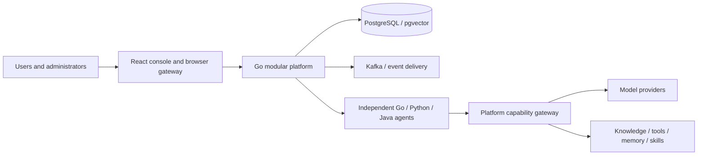

<div align="center">

# AgentPlug

**Build business agents. Share execution, access control and capabilities through one platform.**

[简体中文](README.md) · **English** · [日本語](README_JA.md) · [Deutsch](README_DE.md)

[Problems it addresses](#problems-it-addresses) · [Who it is for](#who-it-is-for) · [Quick start](#quick-start) · [Deployment options](#deployment-options) · [Agent development](#agent-development) · [Architecture](#architecture) · [Developer guide](docs/developer/en/README.md) · [Business agent delivery skill](skills/agentplug-business-agent/SKILL.md)

</div>

AgentPlug is an enterprise agent development, execution and governance platform. Build an agent in **Go, Python or Java**, deploy it independently, and make it available to selected companies, departments and users. Reuse model access, knowledge retrieval, tools, memory, checkpoints and collaboration instead of rebuilding infrastructure for every agent.

The console supports **Chinese / English**, with visible switches on the login page and top bar. Business users can start with the [user guide](docs/用户手册/README.en.md).

## Problems it addresses

Once an agent works as a demo, teams still need to run, deploy, authorize and maintain it. As more agents are developed, these repeated tasks can slow delivery.

| Problem | How AgentPlug addresses it |
| --- | --- |
| Every agent rebuilds model access, retrieval, tools and memory | SDKs expose shared platform capabilities so business code can focus on workflows; each capability still requires configuration and authorization |
| Go, Python and Java teams use different integration and delivery approaches | Three SDK languages, templates and a common execution contract support independently deployed agents |
| A running agent is difficult to deliver to the right company, department and users | Publication, installation, deployment readiness and access are managed separately, with company → department → agent boundaries |
| Assigning permissions one user and action at a time becomes costly and error prone | Company administrators set department limits; department administrators grant access in batches within those limits, with previews and per-user results |
| Failed tasks are difficult to trace, cancel or continue | Shared run states, events, cancellation, conversation history and audit provide troubleshooting and acceptance evidence |
| New developers can read examples but cannot see how to deliver their own agents | Architecture and source maps, capability guides, tutorials and a delivery skill connect development, testing, deployment and organizational access |

## Who it is for

| Audience | What they can do | Start with |
| --- | --- | --- |
| Business agent developers | Implement workflows in Go, Python or Java, reuse shared capabilities and deliver agents to intended users | [Developer onboarding](docs/developer/en/README.md) |
| Enterprise platform teams and architects | Understand execution and governance boundaries, standardize agent integration and evaluate extensions | [Architecture and source map](docs/developer/en/architecture.md) · [Shared capabilities](docs/developer/en/capabilities.md) |
| Platform customizers and open-source contributors | Learn module responsibilities, contracts and extension points | [Extension guide](docs/developer/en/extending.md) |
| Deployment and operations engineers | Choose host, Docker or K8s deployment, configure infrastructure and verify releases | [Deployment guide](docs/developer/en/deployment.md) |
| Company and department administrators | Manage departments and members, define agent access and process batch grants and approvals | [Delivery and organizational access](docs/developer/en/delivery.md) |
| Business users | Find authorized assistants, run tasks and review results and history | [User guide](docs/用户手册/README.en.md) |

Start with a single-host Docker deployment for evaluation. Enterprise production use requires deployment and acceptance checks against your own infrastructure, business data and access rules.

## Start here as a developer

New to AgentPlug? Follow this order to understand the project, run an agent and deliver it to users.

**The [developer documentation](docs/developer/en/README.md) is the guide you read and follow.** It explains architecture, core components, shared capabilities and the boundary between platform responsibilities and business code, then takes you through deployment, configuration, agent development, testing, publication and company / department / user access. Start with its onboarding route; use the architecture, capabilities and extension chapters when customizing the platform.

**The [business agent development and delivery skill](skills/agentplug-business-agent/SKILL.md) is a workflow for your coding assistant.** Give a skill-capable assistant this file, the repository path, business requirements, deployment target and intended company / department / users. It guides implementation, shared-capability reuse checks, tests and authorized deployment / bindings, producing runtime evidence and an acceptance checklist. See [installation and usage](docs/developer/en/skill.md) for direct invocation or installation. Read the developer guide first, use the skill to assist execution, then verify the result with an ordinary business account.

| Step | Start with | Outcome |
| --- | --- | --- |
| 1. Understand the project | [Developer documentation: deployment, architecture, shared capabilities and business development](docs/developer/en/README.md) | Learn the core components and platform / agent responsibilities; choose host, Docker or K8s deployment |
| 2. Run your first agent | [Deployment quick start](docs/developer/en/quickstart.md) → [First business agent tutorial](docs/developer/en/first-agent.md) | Install the base platform, implement business behavior from a template, test it and build an image |
| 3. Deliver with a coding assistant | [Business agent development and delivery skill](skills/agentplug-business-agent/SKILL.md) · [Installation and usage](docs/developer/en/skill.md) | Guide shared-capability reuse review, runtime tests, deployment and company / department / user binding |
| 4. Verify a complete delivery | [Empty platform to ordinary-user run](docs/developer/en/walkthrough.md) | Execute isolated setup, development, tests, independent publication, organizational access and actual user execution; retain evidence and clean temporary resources |

## Core capabilities

| Requirement | Platform support |
| --- | --- |
| Multiple teams developing agents | Three SDK languages, six templates, a common execution protocol and separate deployments |
| Shared model access | Model gateway, operator-managed credentials, versions, pricing and budgets |
| Enterprise knowledge and business tools | Authorized retrieval, controlled tools, memory and skills |
| Department-specific assistants | Company workspace → department → available agents; membership and batch authorization |
| Traceable execution | Runs, events, cancellation, conversation history, audit and evaluation evidence |
| Platform customization | Module boundaries, public contracts, source maps and extension guides |

## Quick start

Use **Docker Compose** for your first installation. Requirements: Python 3.12+, Docker Engine / Docker Desktop, and Compose v2. Run from the repository root:

```text
python -m pip install "cryptography>=43,<46"
python scripts/prepare_local_development.py
python scripts/compose.py config --env-file .env
python scripts/init_platform.py --env-file .env
python scripts/bootstrap_first_admin.py --env-file .env --config .local-secrets/first-admin.json
python scripts/compose.py up --env-file .env
python scripts/compose.py smoke --env-file .env
```

Preparation prompts for your first administrator password and generates independent credentials, execution keys, `.env` and private administrator configuration. It starts no services and refuses to overwrite files. Sign in as **`platform.admin`**, using the password you entered, at **http://127.0.0.1:3000**.

> [!TIP]
> Existing deployments should keep their configuration and accounts. For occupied ports, use `--frontend-port`, `--postgres-port`, `--platform-port`, and `--internal-port` before generation, for example `--frontend-port 33000 --postgres-port 35432`.

An empty agent catalog is expected. After the base stack is ready, develop, publish, deploy and authorize your agent. Model providers are configured separately.

[Steps and expected results](docs/developer/en/quickstart.md) · [Configuration guide](docs/developer/en/configuration.md) · [Troubleshooting](docs/developer/en/troubleshooting.md)

## Deployment options

| Method | Best suited to | Entry point | Current scope |
| --- | --- | --- | --- |
| Local source / host processes | Platform development | `scripts/local.py build` and `local.py run` | Supply PostgreSQL + pgvector and configure each process |
| Docker Compose | Onboarding, integration and single-host operation | Root `compose.yaml` via `scripts/compose.py` | Platform, frontend, PostgreSQL, Kafka and Metric Runner; optional agents |
| Kubernetes | Cluster operations and separate workloads | `deploy/k8s/production/`, Kustomize and `apply.ps1` | Production candidate templates requiring real infrastructure and cluster acceptance |

### Local source deployment

Install Go 1.25+, Node.js 20+, Python 3.12+, and PostgreSQL 16 + pgvector. Java agents also need JDK 21 and Maven. Prepare separate migration, platform, frontend and Runner configuration using the [local deployment guide](docs/developer/en/deployment.md#local-source-and-host-processes).

```text
python scripts/local.py build
python scripts/local.py run migrate --env-file .local-secrets/local/migration.env
python scripts/local.py bootstrap-admin --config .local-secrets/local/first-admin.json
```

Run each long-lived process in its own terminal:

```text
python scripts/local.py run runner --env-file .local-secrets/local/runner.env
python scripts/local.py run platform --env-file .local-secrets/local/platform.env
python scripts/local.py run frontend --env-file .local-secrets/local/frontend.env
```

Application processes run on your host. The frontend template uses port **33000**. Host configuration and root Compose `.env` use different variable names and are not interchangeable.

### Docker Compose

The quick start deploys the base stack. There is one root `compose.yaml`; extensions live under [`deploy/compose/`](deploy/compose/README.md) and are selected by the launcher.

```text
python scripts/compose.py status --env-file .env
python scripts/compose.py down --env-file .env
```

`down` preserves data volumes. `--examples` adds SDK examples after you prepare workload credentials and policies. Optional Code Runtime also requires `--runtime`. See [delivery](docs/developer/en/delivery.md) and the [production Compose reference, Chinese](deploy/compose/README-production.md).

### Kubernetes

The base contains four Deployments—platform, frontend, Metric Runner and OIDC proxy—plus a migration Job, Services, Ingress, NetworkPolicy and external-service overlays.

```text
kubectl kustomize deploy/k8s/production
```

This renders without applying the template. Follow [cluster deployment](docs/developer/en/deployment.md#kubernetes-cluster-deployment) to prepare an operator overlay, real image digests and external Secrets. Use `deploy/k8s/production/apply.ps1` after release preflight and signature verification prerequisites are satisfied.

**The Go platform is currently a modular monolith.** Kubernetes separates the platform, gateway, Runner and agents into services; it does not split every Identity, Catalog or Knowledge module into a microservice. The platform template has one replica. Increasing replicas alone does not establish high availability.

## Agent development

Starting at the repository root:

```text
cd cli/agentctl
go run ./cmd/agentctl create --template python-generic --language python --name support-assistant --output out/support-assistant
go run ./cmd/agentctl validate --path out/support-assistant
cd ../..
```

Put business logic in `domain/` and inject SDK hooks. `platform_entry/` and `template.lock` are template-managed. The [first-agent tutorial](docs/developer/en/first-agent.md) provides runnable hooks, testing, image construction and platform handoff. **Manifest validation does not publish, deploy or authorize an agent.**

| Language | Generic / framework templates | Business example |
| --- | --- | --- |
| Go | `go-generic` / `go-eino` | [Operations assistant](examples/go-operations/README.md) |
| Python | `python-generic` / `python-langgraph` | [Document assistant](examples/python-documents/README.md) |
| Java | `java-generic` / `java-spring-ai` | [Ticket assistant](examples/java-tickets/README.md) |

The [`agentplug-business-agent`](skills/agentplug-business-agent/SKILL.md) skill assists with development, shared-capability review, tests, deployment and company / department / user binding. [Install and invoke it](docs/developer/en/skill.md). It executes concrete plans within authorization and records evidence; health checks are only one part of acceptance.

## Architecture



The control plane owns organizations, identities, versions, installations, policy publication and audit. Execution services manage runs, events, cancellation, recovery and capability calls. Business agents own business workflows and receive neither platform database credentials nor provider keys. Ports, table ownership and architecture tests enforce module boundaries.

[Architecture and source map](docs/developer/en/architecture.md) · [Shared capabilities](docs/developer/en/capabilities.md) · [Extending the platform](docs/developer/en/extending.md)

## Organizations and access

A user belongs to one company workspace and can join multiple departments. Departments have approved agents. A user-facing application means an agent; the internal Application is an installation and policy container.

Platform, company and departmental administrators have distinct scopes. Company administrators set departmental agent limits; departmental administrators allocate access to other members within those limits. Permission administrators are an optional delegated approval role.

Administration does not grant agent execution. Human callers and workload identities need separate authorization. Membership alone does not enable an agent. Batch operations preview impact, require fresh authentication and retain individual outcomes. See the [organization reference, Chinese](docs/开发者指南/公司与部门Agent授权指南.md).

## Documentation and development

| Task | Guide |
| --- | --- |
| Understand and deploy the platform | [Developer learning path](docs/developer/en/README.md) |
| Understand configuration and timing | [Configuration reference](docs/developer/en/configuration.md) |
| Publish, deploy and bind your agent | [Delivery and access](docs/developer/en/delivery.md) |
| Use assistants and manage membership | [User guide](docs/用户手册/README.en.md) |
| Explore SDKs in depth | [SDK reference, Chinese](docs/开发者指南/三语言SDK业务Agent开发指南.md) |
| Evaluate business behavior | [Agent Evaluation](cli/agent-eval/README.md) |
| Back up and recover | [Backup](deploy/backup/README.md) · [Data lifecycle](docs/DATA-LIFECYCLE.md) · [Runtime recovery](docs/RUNTIME-RECOVERY.md) |

Run `go test ./...` in `platform/`; run `npm ci`, `npm test`, `npm run build` in `frontend/`. From the root:

```text
python scripts/check_markdown_links.py
python scripts/check_publication.py
python scripts/scan_secrets.py
python scripts/verify_modular_boundaries.py
```

Database, real-provider and Code Runtime tests require appropriate environments; see [contribution requirements](CONTRIBUTING.md). Isolated empty-database end-to-end entry: `python scripts/compose.py e2e-modular`.

## Current status

The project is under active development. Production acceptance must cover identity, policies, business runs, networking, backups and recovery in the target environment. Kubernetes templates are not evidence of an accepted production cluster deployment.

Optional Code Runtime needs Linux Landlock ABI 3, restricted networking, pinned image digests and explicit risk approval. Generic templates use an in-process `MemoryRunStore` for onboarding; durable recovery and multiple instances require a scoped persistent store and protocol validation.

[Contributing](CONTRIBUTING.md) · [Security reporting](SECURITY.md) · [MIT License](LICENSE) · [Third-party notices](THIRD_PARTY_NOTICES.md)
