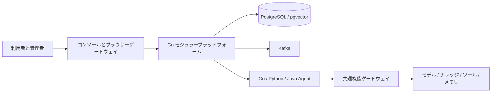

<div align="center">

# AgentPlug

**業務 Agent は業務に集中。実行、権限、共通機能はプラットフォームで管理。**

[简体中文](README.md) · [English](README_EN.md) · **日本語** · [Deutsch](README_DE.md)

[解決する課題](#解決する課題) · [対象ユーザー](#対象ユーザー) · [クイックスタート](#クイックスタート) · [デプロイ方法](#デプロイ方法) · [Agent 開発](#agent-開発) · [アーキテクチャ](#アーキテクチャ) · [開発者ガイド](docs/developer/ja/README.md) · [業務 Agent 導入支援 skill](skills/agentplug-business-agent/SKILL.md)

</div>

AgentPlug は企業向けの Agent 開発・実行・ガバナンス基盤です。**Go、Python、Java** で業務 Agent を作成し、独立してデプロイしたうえで、会社・部門・ユーザーごとに利用範囲を設定できます。モデル、ナレッジ検索、ツール、メモリ、チェックポイント、協調処理を SDK から再利用できます。

コンソールの対応言語は **中国語 / 英語** です。ログイン画面と上部に切り替えボタンがあります。日本語版 README と、日本語 UI の提供は別です。[英語ユーザーガイド](docs/用户手册/README.en.md)も参照できます。

## 解決する課題

Agent のデモが動いても、運用、デプロイ、権限設定、保守が必要です。Agent の数が増えるほど、これらの繰り返し作業が提供までの時間を長くします。

| 課題 | AgentPlug の対応 |
| --- | --- |
| Agent ごとにモデル接続、検索、ツール、メモリを実装している | SDK から共通機能を利用し、業務コードは業務フローに集中する。各機能の設定と権限付与は別途必要 |
| Go、Python、Java のチームで接続・提供方法が異なる | 3 言語 SDK、テンプレート、共通実行契約で独立した Agent のデプロイを支える |
| 起動した Agent を適切な会社・部門・ユーザーに提供できない | 公開、インストール、デプロイ状態、利用権を分けて管理し、会社 → 部門 → Agent の範囲を定める |
| ユーザーごとの細かい権限設定に時間がかかり、誤付与が起きる | 会社管理者が部門の上限を設定し、部門管理者がその範囲で一括付与する。事前プレビューとユーザー別結果を確認できる |
| 失敗したタスクの追跡、中断、会話の継続が難しい | 実行状態、イベント、キャンセル、会話履歴、監査を共通化し、調査と受け入れ確認の証跡を残す |
| サンプルは読めても独自 Agent の提供手順がわからない | 構成とソースマップ、共通機能ガイド、チュートリアル、交付 skill で開発から組織への利用権設定まで案内する |

## 対象ユーザー

| 対象 | 利用目的 | 最初に読む資料 |
| --- | --- | --- |
| 業務 Agent 開発者 | Go、Python、Java で業務フローを開発し、共通機能を再利用してユーザーに提供する | [開発者ガイド](docs/developer/ja/README.md) |
| 企業のプラットフォームチーム・設計者 | 実行と統制の境界を理解し、各チームの Agent 接続や拡張を検討する | [構成とソースマップ（英語）](docs/developer/en/architecture.md) · [共通機能（英語）](docs/developer/en/capabilities.md) |
| 拡張開発者・オープンソース貢献者 | モジュールの役割、契約、拡張点を理解する | [拡張ガイド（英語）](docs/developer/en/extending.md) |
| デプロイ・運用担当者 | ホスト、Docker、K8s を選択し、環境設定とリリース検証を行う | [デプロイガイド（英語）](docs/developer/en/deployment.md) |
| 会社管理者・部門管理者 | 部門とメンバーを管理し、Agent の利用範囲、一括付与、承認を扱う | [Agent の提供と組織への利用権設定（英語）](docs/developer/en/delivery.md) |
| 業務ユーザー | 許可された助手を利用し、タスクの結果と履歴を確認する | [ユーザーガイド（英語）](docs/用户手册/README.en.md) |

評価は単一ホストの Docker 環境から始められます。企業で本番運用する場合は、実際のインフラ、業務データ、権限規則に合わせた導入と検証が必要です。

## 開発者はここから

初めて使う場合は、プロジェクトの理解、最初の Agent の実行、ユーザーへの提供の順に進めてください。詳細な技術ガイドと skill は英語です。

**[開発者ガイド](docs/developer/ja/README.md)は、人が読んで実行する手順書です。** アーキテクチャ、コア構成、共通機能と業務コードの役割を理解し、環境設定、デプロイ、Agent の開発・テスト・公開、会社 / 部門 / ユーザーへの利用権設定まで進められます。初回は入門ルートの順に読み、拡張時は構成・共通機能・拡張の章を参照してください。

**[業務 Agent 開発・導入支援 skill](skills/agentplug-business-agent/SKILL.md)は、コーディング助手に渡す作業手順です。** リポジトリのパス、業務要件、導入先、対象の会社 / 部門 / ユーザーとともに指定すると、実装、共通機能の再利用チェック、テスト、許可されたデプロイと紐付けを支援し、実行証跡と受け入れ確認リストを作成します。[使用方法](docs/developer/en/skill.md)に直接参照とインストールの手順があります。まずガイドで流れを理解し、skill で作業を支援させ、最後に一般ユーザーで結果を確認してください。

| 順序 | 入口 | できること |
| --- | --- | --- |
| 1. プロジェクトを理解する | [開発者ガイド：デプロイ、アーキテクチャ、共通機能、業務開発](docs/developer/ja/README.md) | コア構成とプラットフォーム / Agent の役割を理解し、ローカル、Docker、K8s の方式を選ぶ |
| 2. 最初の Agent を動かす | [デプロイ入門（英語）](docs/developer/en/quickstart.md) → [業務 Agent チュートリアル（英語）](docs/developer/en/first-agent.md) | 基盤を起動し、テンプレートから業務コードを実装、テスト、イメージ構築する |
| 3. コーディング助手で提供まで進める | [業務 Agent 開発・導入支援 skill（英語）](skills/agentplug-business-agent/SKILL.md) · [インストールと使用方法（英語）](docs/developer/en/skill.md) | 共通機能の再利用レビュー、実行テスト、デプロイ、会社 / 部門 / ユーザーの紐付けを支援する |
| 4. 提供の全工程を検証する | [空の基盤から一般ユーザーの実行まで（英語）](docs/developer/en/walkthrough.md) | 隔離環境で導入、開発、テスト、独立した公開、組織への利用権設定と実際の実行を行い、証跡を保存して一時環境を削除する |

## 主な機能

| 要件 | 提供する機能 |
| --- | --- |
| チームごとの Agent 開発 | 3 言語 SDK、6 種類のテンプレート、共通実行プロトコル |
| 共通モデル接続 | モデルゲートウェイ、資格情報、バージョン、料金・予算管理 |
| 企業のナレッジとツール | 権限付き検索、制御されたツール呼び出し、メモリ、Skill |
| 部門ごとの利用管理 | 会社ワークスペース → 部門 → 利用可能 Agent、一括権限付与 |
| 実行の追跡 | イベント、キャンセル、会話履歴、監査、評価証跡 |
| 二次開発 | モジュール境界、公開契約、ソースマップ、拡張ガイド |

## クイックスタート

初回は **Docker Compose** を推奨します。Python 3.12+、Docker Engine / Docker Desktop、Compose v2 が必要です。リポジトリのルートで実行します。

```text
python -m pip install "cryptography>=43,<46"
python scripts/prepare_local_development.py
python scripts/compose.py config --env-file .env
python scripts/init_platform.py --env-file .env
python scripts/bootstrap_first_admin.py --env-file .env --config .local-secrets/first-admin.json
python scripts/compose.py up --env-file .env
python scripts/compose.py smoke --env-file .env
```

準備コマンドで初期管理者のパスワードを入力します。独立したランダム資格情報、署名鍵、`.env`、非公開の管理者設定を生成します。既存ファイルは上書きせず、サービスも起動しません。起動後、**http://127.0.0.1:3000** で **`platform.admin`** と入力したパスワードを使用します。

> [!TIP]
> 既存環境では設定とアカウントをそのまま利用してください。ポートが使用中なら、初回生成時に `--frontend-port 33000 --postgres-port 35432` などを指定します。`--platform-port` と `--internal-port` も変更できます。

初期状態では業務 Agent がありません。基盤の起動後、Agent の開発、公開、デプロイ、権限設定を行います。モデルプロバイダーも別途設定が必要です。[日本語の入門手順](docs/developer/ja/README.md) · [詳細手順、英語](docs/developer/en/quickstart.md) · [設定参考、英語](docs/developer/en/configuration.md)

## デプロイ方法

| 方法 | 用途 | 入口 | 現在の範囲 |
| --- | --- | --- | --- |
| ローカルソース / ホストプロセス | プラットフォームの開発 | `scripts/local.py` | PostgreSQL + pgvector を別途用意し、各プロセスを設定 |
| Docker Compose | 初回利用、統合、単一ホスト | ルート `compose.yaml`、`scripts/compose.py` | 基盤サービスと任意の業務 Agent |
| Kubernetes | クラスタと独立ワークロード | `deploy/k8s/production/` | 本番候補テンプレート。実環境設定と検証が必要 |

### ローカルソース

Go 1.25+、Node.js 20+、Python 3.12+、PostgreSQL 16 + pgvector が必要です。Java Agent には JDK 21 と Maven も必要です。[英語のホスト設定手順](docs/developer/en/deployment.md#local-source-and-host-processes)に従って、4 種類の非公開設定を準備します。

```text
python scripts/local.py build
python scripts/local.py run migrate --env-file .local-secrets/local/migration.env
python scripts/local.py bootstrap-admin --config .local-secrets/local/first-admin.json
```

以下はそれぞれ別のターミナルで実行します。

```text
python scripts/local.py run runner --env-file .local-secrets/local/runner.env
python scripts/local.py run platform --env-file .local-secrets/local/platform.env
python scripts/local.py run frontend --env-file .local-secrets/local/frontend.env
```

フロントエンド設定のポートは **33000** です。ホスト設定と Compose の `.env` は変数名が異なるため、そのまま交換できません。

### Docker Compose

クイックスタートが基本構成の手順です。ルートの入口は 1 つで、拡張構成は [`deploy/compose/`](deploy/compose/README.md) にまとめています。

```text
python scripts/compose.py status --env-file .env
python scripts/compose.py down --env-file .env
```

`down` はデータボリュームを保持します。`--examples` で 3 言語の例を追加できますが、ワークロード資格情報と公開済みポリシーの準備が必要です。Code Runtime はさらに `--runtime` を使用します。[配信と権限設定、英語](docs/developer/en/delivery.md)を参照してください。

### Kubernetes

プラットフォーム、フロントエンド、Metric Runner、OIDC プロキシの 4 Deployment、移行 Job、Service、Ingress、NetworkPolicy を用意しています。

```text
kubectl kustomize deploy/k8s/production
```

このコマンドは描画のみで、クラスタに適用しません。実際のイメージダイジェスト、外部 Secret、ネットワークを設定したオーバーレイを作成し、事前検証と署名確認を経て `apply.ps1` で配信します。[詳細、英語](docs/developer/en/deployment.md#kubernetes-cluster-deployment)。

**Go プラットフォームの内部構造はモジュラーモノリスです。** K8s は基盤、ゲートウェイ、Runner、業務 Agent を別サービスとして扱いますが、Identity、Catalog、Knowledge の全モジュールをマイクロサービス化したわけではありません。候補構成は単一レプリカであり、レプリカ追加だけで高可用性を保証できません。

## Agent 開発

リポジトリのルートから実行します。

```text
cd cli/agentctl
go run ./cmd/agentctl create --template python-generic --language python --name support-assistant --output out/support-assistant
go run ./cmd/agentctl validate --path out/support-assistant
cd ../..
```

業務コードは `domain/` に配置し、SDK のフックへ接続します。`platform_entry/` と `template.lock` はテンプレートが管理します。[最初の Agent、英語](docs/developer/en/first-agent.md)には実行可能な業務コード、テスト、コンテナ構築、導入手順があります。Manifest の検証だけでは公開・稼働・権限付与は完了しません。

| 言語 | テンプレート | 業務例 |
| --- | --- | --- |
| Go | `go-generic` / `go-eino` | [運用アシスタント](examples/go-operations/README.md) |
| Python | `python-generic` / `python-langgraph` | [文書 QA](examples/python-documents/README.md) |
| Java | `java-generic` / `java-spring-ai` | [チケットアシスタント](examples/java-tickets/README.md) |

[`agentplug-business-agent`](skills/agentplug-business-agent/SKILL.md) は開発、共通機能の再利用審査、テスト、配信、会社・部門・ユーザーへの紐付けを支援する skill です。[利用方法、英語](docs/developer/en/skill.md)。

## アーキテクチャ



制御面は組織、認証、バージョン、インストール、ポリシー、監査を管理します。実行面はタスク、イベント、キャンセル、復旧、共通機能呼び出しを管理します。Agent はプラットフォーム DB やモデルプロバイダーの秘密鍵を保持しません。

[構造とコード、英語](docs/developer/en/architecture.md) · [共通機能、英語](docs/developer/en/capabilities.md) · [拡張、英語](docs/developer/en/extending.md)

## 組織と権限

ユーザーは 1 つの会社ワークスペースに所属し、複数部門へ参加できます。会社管理者が部門の利用可能 Agent を指定し、部門管理者はその上限内で他のメンバーに利用権を付与します。権限管理者は任意の委任ロールです。

管理権限は Agent の実行権限を含みません。利用者とワークロードは個別に認可されます。部門への参加だけでは Agent を利用できず、一括付与は影響のプレビューと再認証を行い、各ユーザーの結果を保持します。

## 開発と現在の状態

`platform/` では `go test ./...`、`frontend/` では `npm ci`、`npm test`、`npm run build` を実行します。ルートでは以下を使用します。

```text
python scripts/check_markdown_links.py
python scripts/check_publication.py
python scripts/scan_secrets.py
python scripts/verify_modular_boundaries.py
```

プロジェクトは開発中です。本番では実環境の権限、ポリシー、業務実行、ネットワーク、バックアップ、復旧を検証してください。K8s テンプレートは本番クラスタでの検証完了を意味しません。任意の Code Runtime には Linux Landlock ABI 3、制限されたネットワーク、固定ダイジェスト、明示的なリスク承認が必要です。テンプレートの `MemoryRunStore` は入門用で、永続復旧や複数インスタンスには対応する Store と検証が必要です。

[開発者ガイド](docs/developer/ja/README.md) · [評価ツール](cli/agent-eval/README.md) · [貢献](CONTRIBUTING.md) · [セキュリティ](SECURITY.md) · [MIT License](LICENSE) · [第三者表記](THIRD_PARTY_NOTICES.md)
