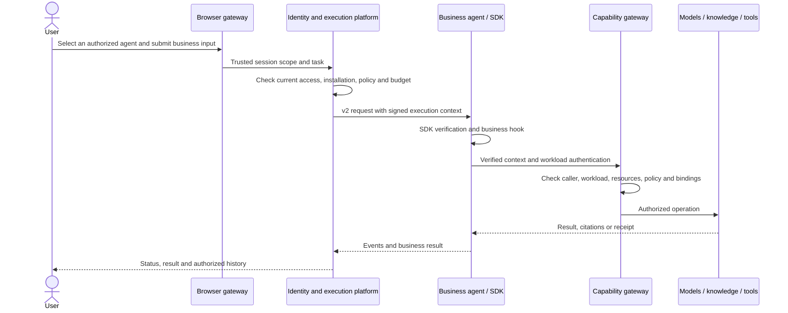

# Architecture and source map

[Developer path](README.md) · [简体中文](../zh/architecture.md)

AgentPlug combines a **modular monolith platform, independent business agents and isolated capability workers**. Deployable services and internal business modules are different boundaries: the platform's Go modules currently share one process.

## A business execution

Browsers cannot declare trusted tenant or workload identity. Agents construct capability context from verified SDK results, not decoded unverified tokens. Denials, budget exhaustion and invalid installations must not fall back to direct provider/database access.

## Core components

| Responsibility | Source | Purpose |
| --- | --- | --- |
| Organizations, users, workloads and administration | [identity](../../../platform/internal/identity/) | Shared personnel and resource authority |
| Authorization decisions | [authorization](../../../platform/internal/authorization/) | Current roles, membership and resource facts |
| Definitions, versions, installations, deployments | [catalog](../../../platform/internal/catalog/) | Distinguish immutable versions from installed deployments |
| Runs, events, cancellation and recovery | [execution](../../../platform/internal/execution/), [runtime](../../../platform/internal/runtime/) | SDK-owned lifecycle and durable platform facts |
| Conversation lifecycle | [conversation](../../../platform/internal/conversation/) | Ownership, content access, sharing, export and deletion |
| Policy drafts and snapshots | [policyasset](../../../platform/internal/policyasset/) | Versioned publication, independent actors, CAS and audit |
| Models, pricing, budgets | [modelgovernance](../../../platform/internal/modelgovernance/), [modelgateway](../../../platform/internal/modelgateway/), [usagecost](../../../platform/internal/usagecost/) | Central credentials, approvals and accounting |
| Sources, indexing and retrieval | [knowledge](../../../platform/internal/knowledge/), [knowledgegateway](../../../platform/internal/knowledgegateway/) | Versioned source evidence and authorized results |
| Tools, memory and capabilities | [toolgateway](../../../platform/internal/toolgateway/), [memorygateway](../../../platform/internal/memorygateway/), [capability](../../../platform/internal/capability/) | Reusable operations under consistent policy |
| Child-agent coordination | [agentcoordination](../../../platform/internal/agentcoordination/) | Delegation, shared budgets, cancellation and gathering |
| Evaluation and audit | [evaluationproduct](../../../platform/internal/evaluationproduct/), [audit](../../../platform/internal/audit/), [metric-runner](../../../workers/metric-runner/) | Isolated evaluation and real evidence |
| Composition | [bootstrap](../../../platform/internal/bootstrap/), [cmd/platform](../../../platform/cmd/platform/) | Inject owning-module ports |

## Repository map

`platform/` contains the Go platform; `frontend/` the React console and Go browser gateway; `sdk/` the three language SDKs; `contracts/` protocols, schemas and architecture boundaries; `templates/` the six agentctl templates; `examples/` complete business examples; `cli/` agentctl and evaluation tools; `workers/` isolated workers; `deploy/` host, Compose and K8s deployment; `skills/` reusable delivery assistance.

Start with the [execution contract](../../../contracts/openapi/agent-execution-v2.yaml), [Manifest schema](../../../contracts/jsonschema/manifest-v1.json), SDK factory and one business example. Reading all platform SQL or `main.go` first is not required for agent integration.

## Data ownership

[table-owners.json](../../../contracts/architecture/table-owners.json) defines platform-table owners. [Architecture contracts](../../../contracts/architecture/README.md) define ports, read projections and dynamic SQL rules. A module does not arbitrarily write another module's tables.

PostgreSQL stores persistent platform facts; pgvector supports knowledge projections. Kafka carries selected events/notifications. Outbox delivery and business outcomes are separate facts; uncertain outcomes require receipt lookup and recovery.

Run `python scripts/verify_modular_boundaries.py` from the root and `go test ./internal/architecture -count=1` in `platform/` when changing these boundaries.

## Service evolution

Agents already have independent deployment boundaries. Extracting a platform module additionally requires port protocols, data ownership, authentication, failure handling, transaction/outbox behavior and observability changes. Adding a Deployment alone does not complete this extraction.
