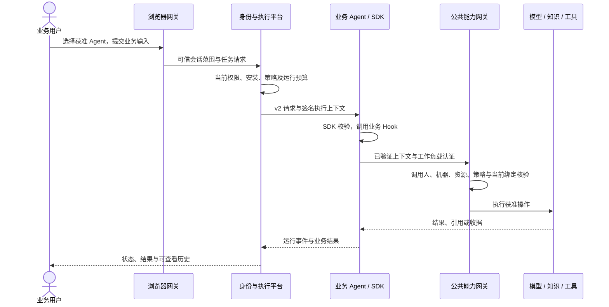

# 架构、核心组件与源码地图

[入门路线](README.md) · [English](../en/architecture.md)

AgentPlug 采用**模块化单体控制平台 + 独立业务 Agent + 隔离能力工作进程**。HTTP 服务可以独立部署，但 Go 平台的业务模块目前共同编译为一个进程。Compose 或 K8s 的容器数不等于业务微服务数。

## 一次业务执行经过什么



浏览器不能自行声明可信租户、Agent 身份或机器凭据。Agent 也不能用解析但未验证的 Token 构造能力上下文。资源拒绝、预算不足和安装失效都是业务可见结果，不能回退到绕过网关的直连路径。

## 核心组件

| 职责 | 源码入口 | 为什么集中在这里 |
| --- | --- | --- |
| 公司、部门、用户、机器、管理边界 | [identity](../../../platform/internal/identity/) | 避免每个 Agent 自建人员和资源权限 |
| 统一权限判定 | [authorization](../../../platform/internal/authorization/) | 管理身份、成员关系、资源授权按当前事实检查 |
| Definition、Version、Installation、Deployment | [catalog](../../../platform/internal/catalog/) | 分离业务版本和各公司实际安装 |
| 执行、事件、取消与恢复 | [execution](../../../platform/internal/execution/)、[runtime](../../../platform/internal/runtime/) | 统一状态与执行证据，不由业务 Hook 重写状态机 |
| 会话和历史数据生命周期 | [conversation](../../../platform/internal/conversation/) | 按归属与内容权限处理历史、分享、导出和删除 |
| 策略草稿和快照发布 | [policyasset](../../../platform/internal/policyasset/) | 版本、发布人、CAS 和审计形成可追溯事实 |
| 模型批准、价格和预算 | [modelgovernance](../../../platform/internal/modelgovernance/)、[modelgateway](../../../platform/internal/modelgateway/)、[usagecost](../../../platform/internal/usagecost/) | 服务凭据和计费控制不下发到 Agent |
| 知识源、索引和检索 | [knowledge](../../../platform/internal/knowledge/)、[knowledgegateway](../../../platform/internal/knowledgegateway/) | 保留来源版本、权限过滤与检索证据 |
| 工具、记忆与能力编排 | [toolgateway](../../../platform/internal/toolgateway/)、[memorygateway](../../../platform/internal/memorygateway/)、[capability](../../../platform/internal/capability/) | 公共操作重复利用，权限和策略保持一致 |
| 子 Agent 与协作 | [agentcoordination](../../../platform/internal/agentcoordination/) | 约束委派、父子预算、取消和汇总 |
| 评测与审计 | [evaluationproduct](../../../platform/internal/evaluationproduct/)、[audit](../../../platform/internal/audit/)、[metric-runner](../../../workers/metric-runner/) | 隔离评测执行，保存真实证据 |
| 装配和运行入口 | [bootstrap](../../../platform/internal/bootstrap/)、[cmd/platform](../../../platform/cmd/platform/) | 注入跨模块端口，而不是把内部 Repository 相互暴露 |

## 仓库目录如何阅读

```text
platform/       Go 控制平台和执行、能力模块
frontend/       React 界面及 Go 浏览器网关
sdk/            Go / Python / Java 公共 SDK
contracts/      执行协议、JSON Schema、OpenAPI、架构约束
templates/      agentctl 可生成的六类工程模板
examples/       三语言完整业务示例
cli/            agentctl、业务评测 CLI 和客户端
workers/        隔离评测及其他工作进程
deploy/         Compose 扩展、主机部署、K8s、备份和可观测性
skills/         可随项目使用的业务 Agent 交付 skill
```

先读公开[执行协议](../../../contracts/openapi/agent-execution-v2.yaml)和 [Manifest Schema](../../../contracts/jsonschema/manifest-v1.json)，再读 SDK 工厂与一个业务示例。不要从全部 SQL 表或平台 `main.go` 开始理解业务接入。

## 模块边界和数据所有权

[表所有权清单](../../../contracts/architecture/table-owners.json)指定每张平台表的拥有模块。[架构说明](../../../contracts/architecture/README.md)定义端口、读取投影和动态 SQL 规则。跨模块功能通过公开端口协作，不让一个模块随意写另一个模块的表。

PostgreSQL 存储平台持久事实；pgvector 用于知识向量投影。Kafka 承担所选事件和通知投递。Outbox 与数据库提交配合；投递成功不等于下游业务结果，未知结果依靠收据、查询和恢复协议处理。

验证边界：

```text
python scripts/verify_modular_boundaries.py
```

平台目录的 `go test ./internal/architecture -count=1` 检查代码 / SQL 约束。新表、动态 SQL 或跨模块读取都要同步维护契约与对应测试。

## 演进为更多服务

业务 Agent 本来就具有独立部署边界。平台模块若需拆成服务，应同时迁移端口协议、数据所有权、认证、故障处理、事务 / Outbox 与可观测性，再证明结果和授权一致。K8s Deployment 文件本身不完成这些工作。
